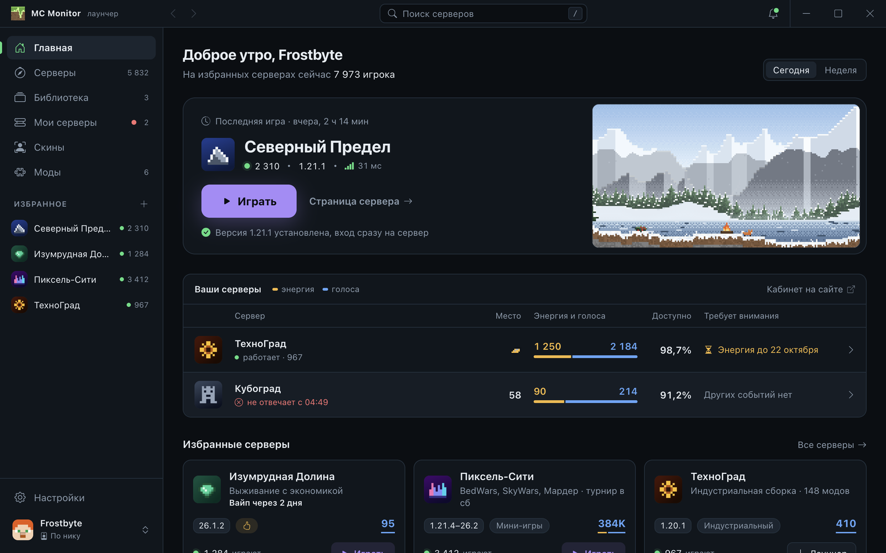

# MC Monitor Launcher

A Minecraft launcher for the Russian-speaking server catalog [MC Monitor](https://mc-mon.ru). Find a server, press Play, and the launcher installs the right game version, checks every file and joins the server. The interface is in Russian.



- Play under any nickname without an account, or sign in with Microsoft. An MC Monitor account is optional: it keeps votes, favourites and your nickname.
- Vanilla Minecraft; Fabric is installed automatically when a mod needs it.
- Mods from the catalog: a server marks them as required, optional or forbidden.
- Skins and capes: players who also play through MC Monitor see yours in game; with a Microsoft account your own skin is used.
- Crash explanations in plain language with a fix button.
- Windows 10 and newer (x64) and macOS 13 and newer on Apple Silicon.

Download the installer from [Releases](https://github.com/user-bigg/mcmon-launcher/releases) or from [mc-mon.ru](https://mc-mon.ru).

## Security

- Game files, Java, Fabric and mods are checked against published hashes; a file that does not match is not run.
- Electron is locked down along its security checklist; CI checks that a tampered app does not start.
- No passwords are typed into the launcher: Microsoft and MC Monitor sign-in happen in the browser.
- Updates are signed; an unsigned or altered update is not installed.
- While it runs, the launcher listens on localhost for the MC Monitor website only, so Play buttons on the site open a server in the launcher.

Found a vulnerability? Report it privately, see `CONTRIBUTING.md`.

## Privacy

The launcher sends to the MC Monitor website (see the [privacy policy](https://mc-mon.ru/privacy)):

- launch statistics with your nickname and mods, and which screens and buttons are used;
- SHA-256 hashes of a few computer identifiers and a virtual machine flag, so one person cannot vote many times or get around a server ban with a new account; servers do not receive them;
- the hardware profile in plain text.

This cannot be turned off. The exact list for your system is in Settings → Privacy. Crash reports stay on your computer.

## Development

You need Node.js 24, npm and bash (Git Bash on Windows).

```
npm ci
npm run dev        # the launcher with demo data and hot reload
scripts/check      # typecheck, ESLint, Prettier and Vitest
npm run dist:win   # Windows installer; needs 32-bit MinGW for the installer plugin (brew install mingw-w64, or mingw-w64-i686-gcc in MSYS2)
npm run dist:mac   # macOS disk image and zip
```

Set `VITE_LAUNCHER_DEMO=off` to use the website API instead of demo data, see `.env.example`. Data lives in `%LOCALAPPDATA%\MC Monitor` and `%APPDATA%\MC Monitor Launcher` on Windows and in `~/Library/Application Support/MC Monitor Launcher` on macOS; uninstalling keeps it.

- `src/main`: the Electron main process: window, IPC, updates, website API, accounts; `launch` installs and runs the game.
- `src/preload`: the `contextBridge` bridge.
- `src/renderer`: the interface in Vue 3.
- `src/shared`: types and rules shared by both sides, interface strings in `i18n`.
- `design/shared`: design tokens and the logo, shared with the MC Monitor website.
- `patches/`: `patch-package` fixes for published packages, pinned to exact versions.

Releases are built only from this repository by GitHub Actions.

## Licence, name and logo

The code is licensed under GPL-3.0-only, see `LICENSE`. Only the client is open: the MC Monitor website and its API are not.

The name “MC Monitor”, the logo and the artwork are not covered by the licence, see `ASSETS.md`. A fork must use its own name, logo, artwork, application ID and update server.

## Contributing

See `CONTRIBUTING.md`.
